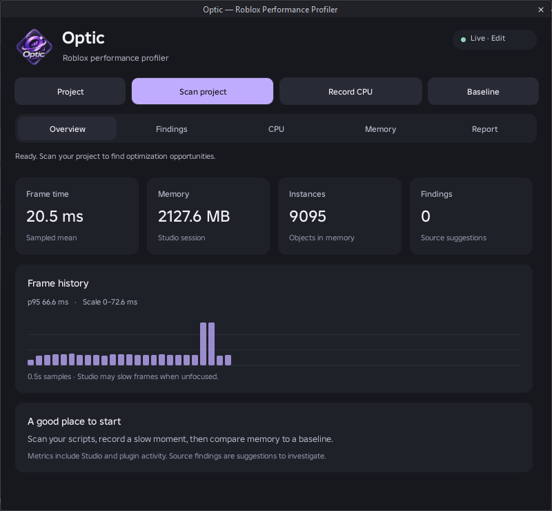

# Optic — Roblox Performance Profiler

Optic is a native Roblox Studio plugin for investigating slow scripts, connection lifecycle risks, and memory growth. It combines local source scanning with measured Studio-session metrics and Roblox's sampling CPU profiler.

**Version:** 0.1.0 · **Runtime dependencies:** none · **Project data:** stays local

The refreshed interface uses Builder Sans, larger text, soft charcoal surfaces and lavender accents, with your supplied Optic logo in the header and toolbar. Overview cards reflow from four columns to two in narrow docks. Reports use Roboto Mono. [Visual refresh checks](test-results/visual-refresh-acceptance.json) cover all five tabs at widths from 426 to 800 pixels.



## Install in Studio

Download **[Optic.rbxm from the latest release](https://github.com/Layfate/Optic/releases/latest/download/Optic.rbxm)**. Use a current Roblox Studio release.

The release also includes `Optic.rbxmx` (XML) and the standalone Luau script. Both model formats contain the same plugin; install only one. Built copies are also under [`dist/`](dist/).

1. Open a temporary/baseplate place in Studio.
2. In Explorer, right-click `ServerStorage` and choose **Insert from File…**. Select the downloaded `Optic.rbxm` (or `Optic.rbxmx`). The imported root is a Script named `Optic` with ModuleScript children.
3. Right-click the imported `Optic` Script and choose **Save as Local Plugin…**. Save it as **Optic**. Depending on the Studio version, this action may also appear in the Plugins tools.
4. Remove the imported Script from the temporary place after saving the local plugin. It is an installation container; it does not belong in a published game.
5. Use the **Optic** button on Studio's Plugins toolbar to open the panel. Restart Studio if the local plugin does not appear immediately.

Optic opens as a floating panel on first launch so Studio cannot squeeze it below Explorer. You can dock it afterward. The action row adapts to narrow docks, including widths below Studio's requested minimum.

Alternative: open Studio's **Plugins Folder** from its Plugins tools, copy the downloaded `Optic.rbxm` there, then restart Studio. You can also use `Optic.plugin.luau` with the filename **`Optic.lua`**. Install one artifact to avoid duplicate plugins. Both model formats preserve readable ModuleScripts for inspection.

No HTTP permission is needed. Source reading uses Studio plugin permissions; if Studio requests script access, grant it to enable analysis. Unreadable sources are counted in scan coverage. CPU capture additionally needs access to the documented profiler service and a running Play context.

## Use Optic

1. **Scan project:** inspect accessible project scripts, excluding Studio's internal CoreGui/CorePackages and plugin trees. Switch **Project** to **Selection** to inspect only selected scripts or containers. Cancel a running scan with the same button.
2. **Findings:** search by path, rule, or recommendation; cycle severity filters; open a finding at its source line. Each row includes evidence, confidence, explanation, and a suggested improvement.
3. **CPU:** start a Studio Play test, choose **client** or **server**, and select **Record CPU**. Reproduce the slow workload. Recording stops automatically after 15 seconds, or select **Stop CPU**. Results arrive asynchronously; unavailable contexts show an error. Client capture requires `Players.LocalPlayer` in the plugin's current DataModel; use server capture if that client is unavailable.
4. **Memory:** select **Set baseline**, exercise the workload, then compare total/category deltas. A positive trend appears only after at least 10 valid observations over 10 seconds.
5. **Report:** choose JSON or Markdown and **Generate report**. The snapshot is frozen so it stays consistent while you copy. Use **Select text**, then **Ctrl+C**, and paste into a local `.json` or `.md` file. Reports over 24,000 bytes are split into UTF-8-safe pages; concatenate pages in order without inserting characters between them. Format changes reuse the frozen snapshot. Generate again to refresh it.

Closing the panel pauses sampling and cancels unfinished work. Small preferences persist; reports, project sources, findings, memory history and CPU captures are not stored in plugin settings.

## What the measurements mean

| Data | Scope and interpretation |
| --- | --- |
| Mean/p95 frame time | Summary of available `Stats.FrameTime` observations sampled every 0.5 seconds, not every rendered frame. A true per-frame p95 would require different instrumentation. |
| Session memory | `Stats:GetTotalMemoryUsageMb()`: OS-reported process/session memory including Studio and plugin overhead. It is not memory attributed to individual scripts. |
| Memory categories | Selected `DeveloperMemoryTag` values, when memory tracking is enabled. Categories and process memory use different accounting and do not add up. |
| Instance count | Engine in-memory instances, including objects outside the active place hierarchy. |
| CPU functions | Native `ScriptProfilerService` sampled **inclusive** CPU time, converted from raw JSON microseconds to milliseconds. Function costs overlap. Session % is function time divided by wall-clock recording duration and can exceed 100% with parallel work. Plugin flags and known Studio plugin source paths identify excluded frames. Unattributed task roots may remain. |
| Connection findings | Source heuristics: creation inside loops and unretained high-frequency callbacks. Optic cannot enumerate every live connection, count listeners belonging to arbitrary scripts, or prove a connection leak. |
| Memory growth | Least-squares trend over the retained history. Loading, caches, garbage collection and editor activity can cause growth. It is an investigation signal, not a diagnosed leak. |

Missing or denied metrics say **Unavailable**. Optic does not substitute invented zeros, rewrite source, insert runtime agents, run project code to analyze it, or send source/telemetry to external services. Exported reports include project paths and measured values, so review them before sharing.

CPU replies are checked against the active recording's session timestamps so delayed snapshots from earlier captures are ignored. The native service is shared with Studio's other profiler tools and exposes no plugin-specific request ID; use one profiler recorder at a time for reliable attribution.

## Scanner rules

| Rule | Severity | Suggested investigation |
| --- | --- | --- |
| `connection-loop` | Warning | Move repeated connection creation out of loops or explicitly manage the lifetime of each listener. |
| `frame-connection` | Info | A known high-frequency signal has no visible same-line assignment. Check ownership and cleanup. |
| `traversal-hotpath` | Warning | Cache repeated `GetDescendants()` / `GetChildren()` results where useful and safe. |
| `legacy-scheduler` | Info | Review global `wait`, `spawn` and `delay`; prefer the `task` library after checking behavior. |

The scanner is a lightweight lexical heuristic, not a complete Luau parser or data-flow analyzer. It ignores comments, quoted/long strings, and whole interpolated string literals (including their embedded expressions). Aliases, wrapper utilities, locally shadowed API names and complex control-flow can cause missed findings or false positives. A nested function in a loop may execute elsewhere; findings explicitly ask for measurement before optimization. No findings means only that these patterns were not detected in the scanned coverage.

Scans yield while traversing the hierarchy, inspect at most 2,000 scripts, skip sources larger than 256 KiB, and retain at most 500 findings. A per-file diagnostic cap also marks partial coverage. Findings show at most 100 filtered rows at a time; reports contain the retained findings. CPU normalization inspects at most 50,000 function entries and retains the top 100; truncation is recorded. Raw profiler JSON is limited to 16 MiB. Metric history retains 120 observations (roughly one minute). API failures are surfaced rather than silently claimed as success.

## Build and test

Node.js 22+ is recommended. Build artifacts require only Node's standard library; tests use pinned `luau-web` 1.5.1 to execute real production Luau in WASM. This is a development dependency, never bundled into the plugin.

```powershell
cd Optic
npm.cmd ci --ignore-scripts
npm.cmd run build
npm.cmd test
```

The build is deterministic and emits both artifacts under `dist/`. Edit `src/`, then rebuild. `npm.cmd` avoids PowerShell's execution policy blocking `npm.ps1`.

To produce the binary release model, install [Rojo](https://rojo.space/docs/v7/getting-started/installation/) (release builds use 7.7.1), then run:

```powershell
npm.cmd run build:rbxm
```

`optic.project.json` packages the same Script root and ModuleScript children as the XML build. Rojo is a build tool only and is not required to use Optic. Release assets include SHA-256 checksums in `SHA256SUMS.txt`.

```text
src/                     Native plugin entry, UI, service adapters and pure core
scripts/build.mjs        Deterministic XML model + standalone script builder
scripts/test.mjs         Real Luau execution and compilation checks
tests/                   Behavioral and packaging tests
docs/IMPLEMENTATION_PROMPT.md
                         Improved reusable implementation brief
docs/superpowers/        Design, plan and verification record
dist/                    Ready-to-install artifacts
```

## Verification and Studio acceptance

Automated checks execute the scanner, numerical calculations, profiler normalization, capture state machine, report sanitization/escaping, native decoder boundary and standalone module loader. They also compile every Luau module and the bundle, check XML source round-trips, compare repeat builds and guard maximum-source scan performance. The current suite has **51 passing checks**.

**Live acceptance completed on November 14, 2026 in Roblox Studio 0.747.0.7471481**, using a separate local test place. A temporary bridge invoked the exact production UI callbacks and inspected native GUI objects; the bridge is absent from the distributed and final installed packages. Test evidence is in [`test-results/studio-acceptance.json`](test-results/studio-acceptance.json).

- [x] Local `.rbxmx` plugin loaded, all five tabs rendered, floating default and 426-pixel action-row layout checked.
- [x] Project scan read all three fixture scripts, found the expected connection warning at line 3, and opened its source document.
- [x] Overlapping selections deduplicated correctly; cancellation preserved partial coverage.
- [x] Live frame/memory/category measurements and memory baseline worked; closing the panel paused sampling.
- [x] JSON and Markdown generated; a 51-finding report split into two pages and reassembled into valid JSON. Native read-only report focus and selection were checked.
- [x] Real client and server 15-second captures completed. The controlled client function measured 122.549 ms; the server function measured 19.043 ms in this run. These are inclusive sampled costs over each session, not benchmark promises.
- [x] Closing during capture cancelled it; Play exit during capture and repeated test-plugin reloads produced no console errors.

Live testing exposed and fixed a decoder mismatch: `ScriptProfilerService:DeserializeJSON()` converts duration values to seconds and strips flags, so Optic now consumes the raw JSON schema directly. Some native plugin frames also have zero flags in this Studio build; known `user_`, `cloud_`, `builtin_` and `sabuiltin_` source paths are excluded as a fallback.

The following broader checks remain useful before publishing: manual Save-as-Local-Plugin installation, OS clipboard round-trip, denied source/profiler permissions on another machine, very large real projects, a fully empty place, and comparison with Roblox's profiler UI across varied workloads. Failure/timeout/lexical edge cases are covered by automated tests but were not all forced in the engine.

## API references

- [Local plugin installation and workflow](https://create.roblox.com/docs/studio/plugins)
- [ScriptProfilerService](https://create.roblox.com/docs/reference/engine/classes/ScriptProfilerService)
- [Script Profiler schema, units and inclusive views](https://create.roblox.com/docs/studio/optimization/scriptprofiler)
- [Stats and memory accounting](https://create.roblox.com/docs/reference/engine/classes/Stats)
- [Plugin dock widgets and settings](https://create.roblox.com/docs/reference/engine/classes/Plugin)
- [ScriptEditorService](https://create.roblox.com/docs/reference/engine/classes/ScriptEditorService)
- [ScriptDocument source selection](https://create.roblox.com/docs/reference/engine/classes/ScriptDocument)
